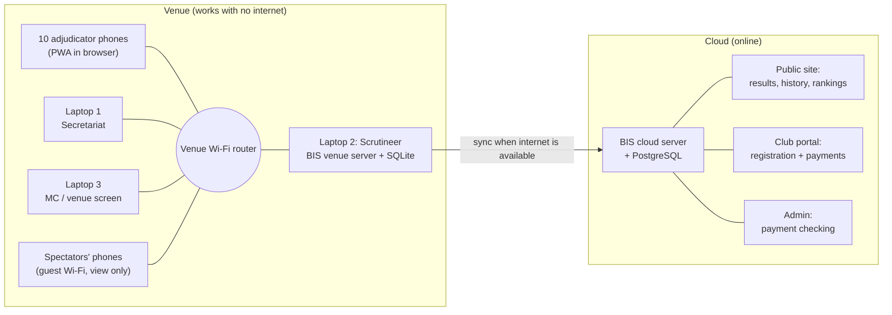
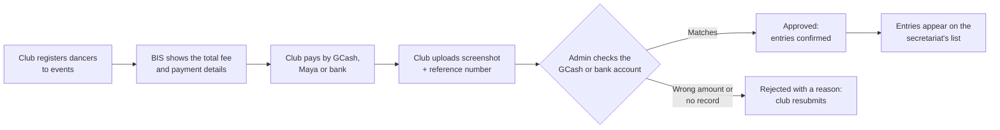

# How to Build BIS

**BIS (Bicol Information Scrutineering System)** is one web app that runs in two places: on a laptop at the venue, where it works with no internet, and on a cloud server, where it handles registration, payments and public results. This guide covers the tech stack, the architecture, and the build order from frontend to backend.

## Tech stack

| Layer | Choice | Why |
| --- | --- | --- |
| Language | **TypeScript** everywhere | One language for frontend, backend and the scoring engine; types catch mistakes in scores |
| Frontend | **React + Vite** | Fast to build screens for each role; huge community |
| Styling | **Tailwind CSS** | Quick, consistent screens without writing much CSS |
| Offline support | **PWA** (vite-plugin-pwa) | Adjudicators' phones and laptops keep working if Wi-Fi drops; no app store needed |
| Backend | **Node.js + Fastify** | Light and fast; runs well on an ordinary laptop |
| Real-time | **Socket.IO** | Pushes every adjudicator's mark to all screens instantly over the venue Wi-Fi |
| Venue database | **SQLite** (better-sqlite3) | A single file; nothing extra to install or keep running on the venue laptop; back up by copying one file |
| Cloud database | **PostgreSQL** | Built for many people online at once (registration, payments, public results); reliable backups; available as a managed service |
| Database access | **Drizzle ORM** | Defines the tables once and works with both SQLite and PostgreSQL |
| Printing | **Print-ready HTML pages** (A4 CSS) | Prints from any browser or saves as PDF; no extra software |
| Testing | **Vitest** | Tests the scoring engine against real published results |
| Cloud hosting | Small VPS (e.g. DigitalOcean) | Runs the online site and receives uploads from venues |

**Why not Next.js?** Next.js is React with a built-in server. Its main strength is public pages that rank well on Google. BIS is mostly a live, offline-first app for staff and adjudicators, and plain React with a small Fastify server is simpler to run on a laptop and to connect to Socket.IO. If the developer knows Next.js much better than plain React, Next.js with a custom server also works.

**Why SQLite at the venue?** MySQL or PostgreSQL would be a separate server program that has to be installed, configured and kept running on the venue laptop; SQLite is just a file inside BIS, so there is less to go wrong on competition day.

**Why PostgreSQL in the cloud?** The cloud handles registration, payments and public pages, where many people may be online at the same time. PostgreSQL handles that well, keeps payment records safe with strong transactions, and has dependable backup tools.

## One database design, two copies

BIS keeps the same database in two places that sync with each other:

| Copy | Where | Why it's needed |
| --- | --- | --- |
| Venue copy (SQLite) | Scrutineer's laptop (Laptop 2) | Runs the whole competition with no internet |
| Cloud copy (PostgreSQL) | Cloud server | Registration, payments, public results, history and rankings when the venue laptop is off |

Adjudicators' phones only hold a temporary copy of their own marks until they reach the venue server; this is not a separate database.



- **Before the competition (online):** clubs register dancers and upload proof of payment; the admin approves payments; the secretariat downloads the confirmed entry list **and the current rankings** to the venue server.
- **At the competition (offline):** everything runs on the venue Wi-Fi. Adjudicators' marks reach the scrutineer's laptop in real time, and every screen updates instantly.
- **Rankings update at the venue in real time:** when the scrutineer approves a result, the venue server adds the ranking points immediately, and every device on the venue Wi-Fi sees the new rankings, with no internet needed.
- **After each approved result:** results and ranking points wait in an upload queue and sync to the cloud whenever internet is available, live during the event or afterwards. The public website then shows the same rankings as the venue.

### Venue Wi-Fi networks

| Network | Who joins | What they can open |
| --- | --- | --- |
| Staff network (password-protected) | Adjudicators' phones, the 3 laptops | All BIS screens for their role |
| Guest network (optional) | Spectators, dancers, parents | Results and rankings only, read-only |

Keeping spectators on a separate guest network means nobody in the crowd can reach the scoring screens.

## Project structure

One code repository with shared parts:

```
scrutineering-system/
  frontend/       React frontend (all roles' screens)
  backend/        Node.js backend (venue mode and cloud mode)
  packages/
    scoring/      Skating System engine (no UI, fully tested)
    shared/       Types and data shapes used by frontend and backend
```

The same server code runs in **venue mode** (no internet needed) or **cloud mode** (adds registration, payments and public pages), set by one setting. Both modes use SQLite with the same table design defined once in Drizzle. PostgreSQL was planned for the cloud but would have meant rewriting every service to be asynchronous, so the cloud runs SQLite as one server with a backup after every change (see PHASE5_README.md). Moving to PostgreSQL later is possible if the cloud ever needs more than one server.

## Build order, frontend to backend

### Phase 1: Screens with sample data (frontend)

Build every screen first, using fake data, so the client can click through and approve the flow before any backend exists.

1. **App shell:** sign-in, a menu per role, the venue online/offline indicator.
2. **Admin:** competitions, staff accounts, adjudicator panels and PINs, points table, payment checking.
3. **Secretariat:** events (E1 to E100+), competitors and back numbers, scratches, schedule, heat and recall printouts.
4. **Adjudicator (phone):** PIN sign-in, X marking for early rounds, 1st to 6th/7th placing for finals, a clear "Submitted" confirmation. Large buttons, works one-handed.
5. **Scrutineer:** live submission board (who has marked), recall count with cutoff and ties, heat setup, Skating System table, approve and publish.
6. **MC / venue screen:** recalls, finalists, results from last place up.
7. **Printouts:** "Qualified for the next round" lists (like the E47 sheet), scores sheets with every adjudicator's marks, final results.
8. **Public site:** latest results, past competitions, couple/solo profiles, rankings per category.
9. **Club portal:** register dancers to events, see the fee, upload proof of payment, see payment status.

### Phase 2: Scoring engine (shared package)

1. Callback counting: total X marks per competitor, recall the top N, flag ties at the cutoff.
2. Skating System for a single-dance final (Rules 5–8).
3. Skating System for multi-dance finals (Rules 9–11), since WDSF events include 2- to 5-dance events.
4. Placings for competitors knocked out in earlier rounds (shared places such as 13th–18th).
5. Ranking points from the editable points table.
6. **Test against real results:** collect published results (for example from danceresults-competition.net), feed in the marks, and confirm BIS produces the same placings every time.

### Phase 3: Venue backend

1. Database tables (see the data model below) in SQLite, with write-ahead logging (WAL) turned on so many devices can read while marks are saved.
2. API endpoints for each screen built in Phase 1; replace the fake data with real calls.
3. Logins: staff accounts with passwords; adjudicators with a PIN per competition; each role sees only its own screens.
4. **Real-time:** every submitted mark is broadcast with Socket.IO to the scrutineer, secretariat, chairperson and venue screen; approved results and updated rankings are broadcast to every connected device, including the guest network.
5. Validation: an adjudicator must mark exactly the recall number, and use each final placing once.
6. Audit log: every mark and every change is recorded with who made it and when.
7. Automatic backups of the database file to a USB drive and to Laptop 3.

### Phase 4: Offline safety

1. Make the web app a PWA so it opens even if the connection drops.
2. Save each adjudicator's marks on the phone first, then send; resend automatically after a Wi-Fi drop.
3. The scrutineer screen shows any phone that has gone quiet.
4. Paper fallback: printable blank mark sheets that the scrutineer can type in.

### Phase 5: Cloud backend and sync

1. Deploy the same server in cloud mode with PostgreSQL.
2. **Upload queue:** approved results, ranking points, entries and scratches are stored in an "outbox" on the venue server and sent to the cloud when internet is available.
3. **Download before an event:** the secretariat pulls the confirmed, paid entry list and the current rankings from the cloud to the venue server.
4. Public pages read from the cloud: results, history, rankings.

### Phase 6: Registration and payments (cloud)

See the payment flow below.

### Phase 7: Testing and pilot

1. Re-run a past competition through BIS end to end.
2. Load test with 10 phones marking at once.
3. Pilot at a real competition with the current method running alongside.

## Payment system (checked manually by the admin)

Clubs pay entry fees outside BIS (GCash, Maya, bank transfer, or cash at the venue), and the admin confirms each payment by hand. BIS never handles card details or money directly.



| Payment status | Meaning | Who sets it |
| --- | --- | --- |
| Unpaid | Registered, no proof uploaded yet | BIS |
| For checking | Proof uploaded, waiting for the admin | BIS |
| Approved | Admin confirmed the money arrived | Admin |
| Rejected | Proof didn't match; reason shown to the club | Admin |
| Paid at venue | Paid in cash on the day | Secretariat |

What the admin sees for each payment: club name, dancers and events, amount due, amount and reference number entered by the club, the uploaded screenshot, and Approve / Reject buttons with a reason field. Every decision is logged with the admin's name and time.

Rules:
- Only approved or paid-at-venue entries can dance, unless the admin allows an exception.
- Receipts are stored privately on the cloud server and are visible only to admins.
- Many dancers are minors, so registration collects only what is needed and follows the Data Privacy Act of 2012.

Registration and payments need internet, so they run on the cloud server only. On the day, the secretariat can still add late entries and mark cash payments at the venue; these sync up later.

## Data model

| Table | Holds |
| --- | --- |
| competitions | Name, date, venue, organizer |
| events | Event number (E47), age group, class, discipline, dances, solo or couple |
| competitors | Names, back number, club |
| entries | Which competitor is in which event, scratch status |
| clubs | Club or team details and contact |
| payments | Club, amount, reference number, receipt file, status, checked by, checked at |
| adjudicators | Name, letter, PIN per competition |
| panels | Which adjudicators adjudicate which event |
| rounds | Event, round type, recall number, status |
| heats | Round, heat number, competitors in the heat |
| marks | Round, adjudicator, competitor, dance, X or placing, time submitted |
| results | Event, competitor, final place, approved by, approved at |
| points_table | Placing and points (editable by the admin) |
| ranking_points | Competitor, category, competition, points |
| staff_users | Name, role, password |
| audit_log | Who changed what, and when |
| outbox | Items waiting to upload to the cloud |
