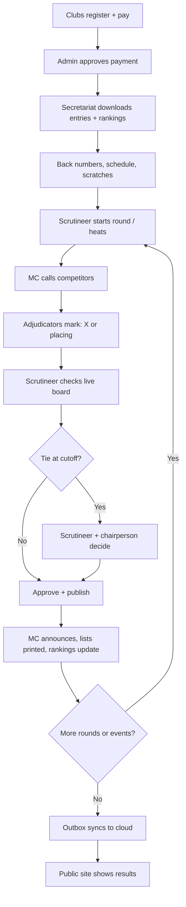

# BIS Competition Flow

How BIS is used from registration to published results. See [ROLES_README.md](ROLES_README.md) for roles and terms, and [BUILD_README.md](BUILD_README.md) for architecture.

## 1. Weeks before (online, cloud)

1. **Admin** creates the competition, staff accounts, adjudicator panels with a PIN each, and the points table.
2. **Clubs** register their dancers to events and see the total fee. They pay outside BIS (GCash, Maya or bank), then upload a screenshot and reference number.
3. **Admin** checks each payment against the account and approves it, or rejects it with a reason. Only approved entries can dance.

## 2. Day before or morning of (setup)

4. **Secretariat** downloads the confirmed entry list and current rankings from the cloud to Laptop 2, the venue server.
5. **Secretariat** assigns back numbers, builds the schedule (E1, E2 and so on), and handles scratches and late entries. Cash payments are marked "Paid at venue" and sync later.
6. The venue Wi-Fi goes up. Staff laptops and adjudicator phones join the password-protected network. Spectators join the guest network, which is view-only.

## 3. Running each event (offline, venue Wi-Fi)

This loop repeats for every round of every event.

1. **Scrutineer** starts the round. If the field is too big for the floor, the scrutineer splits it into heats. The secretariat prints the heat list.
2. **MC** calls the competitors to the floor.
3. **Adjudicators** watch and mark on their phones:
   - **Early rounds** (Round 1, quarter-final, semi-final): mark an X for each competitor to recall, exactly the recall number.
   - **Final:** place the finalists 1st to 6th or 7th, using each place once.
   - Marks are saved on the phone first, then sent. They resend automatically after a Wi-Fi drop. The phone shows "Submitted".
4. **Scrutineer** and **chairperson** watch the live board to see who has submitted and which phones went quiet.
5. **Scrutineer** reviews the result:
   - **Early rounds:** X marks are totalled and the top N are recalled. Any tie at the cutoff is flagged, and the scrutineer and chairperson decide it together.
   - **Final:** the Skating System turns the placings into final places.
6. **Scrutineer** approves and publishes. Ranking points are added immediately and the result is queued in the outbox for upload.
7. **MC screen** shows recalls, finalists or results from last place up. The secretariat prints the "Qualified for the next round" list. Spectators see the update on their phones.
8. The next round starts, then the next event.

### If something fails

| Problem | Fallback |
| --- | --- |
| Phone dies or goes quiet | Adjudicator uses another device, or the scrutineer enters marks from a paper sheet |
| Wi-Fi drops | Phones keep marks locally and resend automatically |
| Laptop 2 fails | Laptop 3 takes over as the backup server |
| Data loss | Database file is backed up automatically to a USB drive and Laptop 3 |

## 4. After the event (sync)

- The outbox uploads approved results, ranking points, entries and scratches to the cloud whenever internet is available, live or afterwards.
- The **public site** then shows results, past competitions, couple and solo profiles, and rankings.
- Printouts are available for the scores sheet (every adjudicator's marks) and the final results.
- The audit log records every mark and change.

## Who does what, by stage

| Stage | Admin | Secretariat | Scrutineer / Chair | Adjudicators | MC | Public |
| --- | --- | --- | --- | --- | --- | --- |
| Before | Approves payments | | | | | Clubs register |
| Setup | | Imports entries, assigns back numbers | | | | |
| Each round | | Prints heat lists | Starts round, resolves ties, approves | Mark X or place | Announces | Watch live |
| After | | | | | | See synced results |

## Flow diagram

