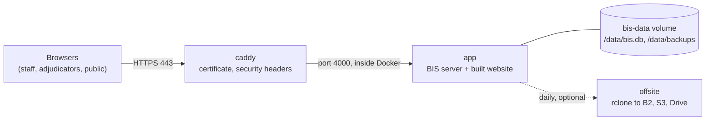

# Setting up production

How to put the real BIS server online, build it, update it and look after it. Staging, the practice server, is in [STAGING.md](STAGING.md). The reference for each setting and for backups is [README.md](README.md).

Everything here runs on the **production server** unless a step says "on your computer". Commands starting with `docker compose` are run inside the `deploy/` folder of the repository.

## What you are building



- **caddy** gets and renews the HTTPS certificate by itself and adds the security headers.
- **app** is one program: the API, the live updates and the website. There is no second server and no sync.
- **bis-data** is a Docker volume that holds the database file and its backups. Losing it loses the competition, so see Backups below.
- **offsite** is optional and copies the newest backups to storage outside the server.

## What you need first

| Need | Details |
| --- | --- |
| A server | Linux with Docker Engine and the Docker Compose plugin. 2 GB memory, 1 CPU and 50 GB disk is enough (see [../ONLINE_SETUP.md](../docs/operations/ONLINE_SETUP.md) for the price) |
| A domain | For example `bis.example.com`, with an **A record pointing at the server's IP address** before you start. Caddy cannot get a certificate until it does |
| Open ports | 80 and 443 to the world (80 is how the certificate is checked). Keep 22 for SSH only |
| The code | Access to the repository from the server (`git clone`) |
| Two secrets | A `DATA_KEY` (32 or more random characters) and, if you want, a `COOKIE_SECRET`. Make them on the server: `openssl rand -hex 32` |

## Where things are

| What | Where |
| --- | --- |
| The compose file (services, ports, volumes) | `deploy/docker-compose.yml` |
| The build recipe for the app image | `deploy/Dockerfile` |
| The web server, headers and security policy | `deploy/Caddyfile` |
| Your settings (never commit this) | `deploy/.env`, copied from `deploy/.env.example` |
| The offsite copy script | `deploy/offsite.sh` |
| The database and backups | The `bis-data` Docker volume, at `/data` inside the app container |
| Certificates | The `caddy-data` Docker volume |
| `deploy/docker-compose.override.yml` | For a developer's computer only: it publishes port 4000 on the machine's own loopback address. It is loaded automatically, so remove it or ignore it on the server; it is harmless there because it only listens on 127.0.0.1 |

## Set up (once)

### 1. Prepare the server

```
ssh <user>@<server ip>

# Docker, if it is not installed yet (Ubuntu or Debian)
curl -fsSL https://get.docker.com | sh
sudo usermod -aG docker $USER      # then log out and back in

# Firewall: SSH, HTTP and HTTPS only
sudo ufw allow OpenSSH && sudo ufw allow 80 && sudo ufw allow 443 && sudo ufw enable
```

Make sure the clock is right, because it decides which competition is current and which PINs work:

```
timedatectl status          # "System clock synchronized: yes"
sudo timedatectl set-ntp true
```

### 2. Get the code

```
git clone <repository url> bis
cd bis/deploy
```

### 3. Write the settings

```
cp .env.example .env
nano .env
```

| Setting | Set it to |
| --- | --- |
| `DOMAIN` | The address people will use, for example `bis.example.com` |
| `DATA_KEY` | The output of `openssl rand -hex 32`. **Keep a copy outside the server**; if it is lost, staff set up two-step sign-in again |
| `COOKIE_SECRET` | Leave empty and the server makes and keeps its own |
| `ADJUDICATOR_PIN_DAYS` | `1`: a PIN works one day either side of the competition date. Never `off` in production |
| `PUBLIC_RATE_LIMIT` | `600` requests a minute per address. Keep it generous: a venue's mobile network shares addresses |
| `OFFSITE_REMOTE` and `RCLONE_CONFIG_OFFSITE_*` | Where the daily backup copy goes (see Backups). Leave empty to skip |

### 4. Build and start

```
docker compose up -d --build
docker compose ps                  # app and caddy: running (app turns "healthy")
docker compose logs -f app         # Ctrl+C to leave; look for "BIS server on http://0.0.0.0:4000"
```

The first build takes a few minutes: it installs the packages and builds the website. Database tables are created and updated by the server when it starts, so there is no separate migration step.

### 5. Make the first admin

```
docker compose exec app node_modules/.bin/tsx src/db/create-admin-cli.ts <email> "<Full name>"
```

It prints a temporary password once. Give it to that person in private. They sign in at `https://<DOMAIN>/staff-access` and change it.

### 6. Check it

```
curl https://<DOMAIN>/api/health          # {"status":"ok", ...}
```

Then, in a browser:

1. Open `https://<DOMAIN>`: the home page loads over HTTPS and the browser console shows no Content-Security-Policy errors.
2. Sign in at `/staff-access` as the admin.
3. Open **Fees and payment details** and save the fees and where to pay. Until this is saved, teams cannot enter events.
4. On **Staff accounts**, add the secretariat, and a second admin (so one lost phone does not lock everyone out). Other staff only when an event needs them.
5. Turn on two-step sign-in under **Security** for the admin, and save the recovery codes offline.

Account details and the rules for passwords are in [../ROLE_ACCOUNTS.md](../docs/operations/ROLE_ACCOUNTS.md). Do not use the sample accounts on this server: the server refuses to load the sample data, and their password is public.

### 7. Turn on the offsite backup (recommended)

Fill in `OFFSITE_REMOTE` and the `RCLONE_CONFIG_OFFSITE_*` settings in `.env`, then:

```
docker compose --profile offsite up -d
docker compose logs offsite                # "offsite copy done" once a day
```

## How the build works

`docker compose up -d --build` builds `deploy/Dockerfile` with the repository as its context:

1. **Build stage** (Node 24): `pnpm install --frozen-lockfile`, then `pnpm --filter frontend build`, which writes the website to `frontend/dist`.
2. **Run stage:** copies the result and starts the server with `node_modules/.bin/tsx src/main.ts`, serving the API and the built website on port 4000. The image sets `BIS_DEPLOYED=true`, `COOKIE_SECURE=true` and `TRUST_PROXY=1`, so it needs a real `DATA_KEY`, sends cookies only over HTTPS and trusts only Caddy.

To check the image without Caddy, from the repository root:

```
docker build -f deploy/Dockerfile -t bis-cloud .
```

## Releasing an update

Do this in order, and only after the same commit has passed on staging ([STAGING.md](STAGING.md)).

**On your computer, before pushing:**

```
pnpm test                       # every package's tests
cd frontend && npx tsc -b       # type check (not --noEmit: it checks nothing here)
cd ../backend && npx tsc -b
cd .. && pnpm build             # the website builds
git push
```

**On the production server, in `deploy/`:**

```
git pull
docker compose up -d --build
docker compose ps
curl https://<DOMAIN>/api/health
docker compose logs --tail 50 app
```

Do not update during a competition. The app restarts for a few seconds, and phones keep their marks and send them again, but there is no reason to risk it.

**Rolling back:** `git log --oneline`, `git checkout <the previous commit>`, `docker compose up -d --build`. Database changes only move forward. If the release changed the database layout, restore the backup taken before it (see Restore) instead of only rolling the code back.

## Backups

- The server copies the database into `/data/backups` about a second after every change and on an interval (`BACKUP_INTERVAL_MINUTES`, default 5), and thins out old copies. The scrutineer and the admin see a warning if a backup folder fails.
- That protects against mistakes and a bad restart, not against losing the server. Copy it away daily with the offsite service above, or by hand:

```
docker compose cp app:/data/backups ./offsite
```

**Restore:**

```
docker compose stop app
# put the chosen backup in the volume as bis.db, for example from ./offsite
docker compose cp ./offsite/bis-<the chosen timestamp>.db app:/data/bis.db
docker compose start app
```

Test a restore once, before you need it. Take a backup, and open it, before every competition.

## Everyday commands

| Task | Command |
| --- | --- |
| Is everything running | `docker compose ps` |
| Watch the app | `docker compose logs -f app` |
| Watch the certificate and proxy | `docker compose logs -f caddy` |
| Restart the app | `docker compose restart app` |
| Stop everything | `docker compose down` (the volumes, and so the data, stay) |
| Update Caddy itself | `docker compose pull caddy && docker compose up -d` |
| Disk use | `docker system df` and `df -h` |
| Change a setting | edit `.env`, then `docker compose up -d` |
| Change the security policy | edit `Caddyfile`, then `docker compose up -d` (if something legitimate is blocked, add its source to the policy) |

**Never run `docker compose down -v`.** The `-v` deletes the volumes, including the database.

Run only one copy of the app. Do not scale it up.

## If something goes wrong

| Problem | What to check |
| --- | --- |
| Site does not load, certificate error | DNS points at this server; ports 80 and 443 are open; `docker compose logs caddy` |
| App will not start: "Set DATA_KEY…" | `DATA_KEY` in `.env` is empty or shorter than 32 characters |
| `/api/health` is not ok | `docker compose logs app`; a database or backup folder problem shows here |
| Backup warning on screen | A backup folder failed; check disk space with `df -h` |
| Adjudicator's PIN refused | Wrong day (see `ADJUDICATOR_PIN_DAYS`), or a new PIN was made. The admin generates a new one |
| Everyone signed out after an update | Expected only if `COOKIE_SECRET` changed. Leave it empty or keep it the same |
| Many people blocked at the venue | Raise `PUBLIC_RATE_LIMIT`, then `docker compose up -d` |

## Before each competition

Use [../FLOW.md](../docs/product/FLOW.md), part 1.8, and the rehearsal tools in [../rehearsal/README.md](../rehearsal/README.md): the server's clock, `ADJUDICATOR_PIN_DAYS`, a backup you have opened, `/api/health`, the PINs and their cards.
