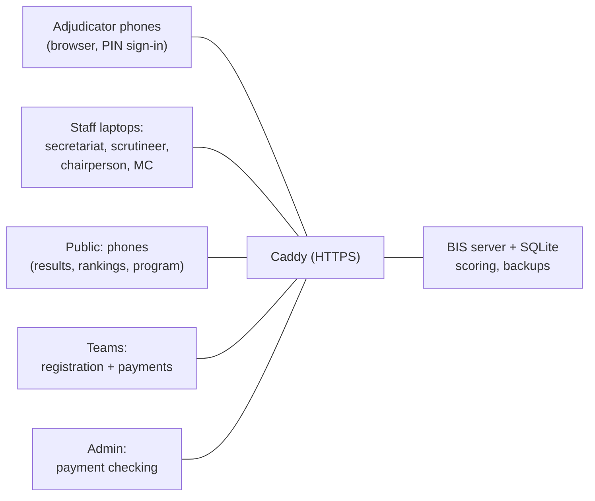
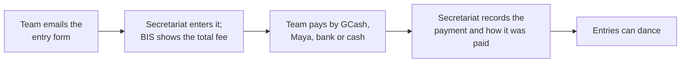

# How to Build BIS

**BIS (Bicol Oragon Scruteneering System)** is one online web app: one server handles registration, payments, public results and the running of the rounds. This guide covers the tech stack, the architecture, and the build order from frontend to backend.

## Tech stack

| Layer | Choice | Why |
| --- | --- | --- |
| Language | **TypeScript** everywhere | One language for frontend, backend and the scoring engine; types catch mistakes in scores |
| Frontend | **React + Vite** | Fast to build screens for each role; huge community |
| Styling | **Tailwind CSS** | Quick, consistent screens without writing much CSS |
| Backend | **Node.js + Fastify** | Light and fast; runs well on a small server |
| Real-time | **Socket.IO** | Pushes every adjudicator's mark to all screens instantly over the internet |
| Database | **SQLite** (better-sqlite3) | A single file; nothing extra to install or keep running; back up by copying one file |
| Database access | **Drizzle ORM** | Defines the tables once, with migrations |
| Printing | **Print-ready HTML pages** (A4 CSS) | Prints from any browser or saves as PDF; no extra software |
| Testing | **Vitest** | Tests the scoring engine against real published results |
| Hosting | Small VPS (e.g. DigitalOcean), Docker, Caddy for HTTPS | Runs the whole system; see `deploy/` |

**Why not Next.js?** Next.js is React with a built-in server. Its main strength is public pages that rank well on Google. BIS is mostly a live app for staff and adjudicators, and plain React with a small Fastify server is simpler to run and to connect to Socket.IO. If the developer knows Next.js much better than plain React, Next.js with a custom server also works.

**Why SQLite?** MySQL or PostgreSQL would be a separate server program to install, configure and keep running; SQLite is just a file inside BIS, so there is less to go wrong on competition day. One server with a backup after every change is enough for one organizer. PostgreSQL would mean making every service asynchronous and is only worth it if BIS ever needs more than one server.

## One online server

BIS is one web app on one online server. The server runs behind Caddy over HTTPS in Docker (see `deploy/`) and does everything: team registration and payments, the public pages, and running the rounds. Staff (secretariat, scrutineer, chairperson, MC) use laptops with a browser and internet; adjudicators sign in on their phones with a PIN over the internet, on mobile data or any Wi-Fi with internet. There is no venue server and no separate venue network.

There is one database, a SQLite file on the server. Adjudicators' phones hold only a temporary copy of their own marks until the server has them; this is not a separate database.



- **Before the competition:** teams send the entry form; the secretariat enters it, works out the fee and records the payment; athletes can make an account and report their membership payment for the secretariat to confirm; the secretariat assigns back numbers and builds the schedule and program.
- **At the competition:** adjudicators' marks reach the scrutineer in real time, and every screen updates instantly. If a phone loses its connection, it keeps its marks and resends them automatically; the scrutineer's board shows which phones hold marks.
- **Rankings update in real time:** when the scrutineer approves a result, the server adds the ranking points immediately and every connected device sees the new rankings.
- **Public pages** show only published results, rankings and the program.
- **Backups:** the database is copied to `BACKUP_DIRS` (default `/data/backups`) after every change and on an interval, with an optional daily offsite copy. The scrutineer and admin see a warning if a folder fails.
- **The server's clock decides which competition is current**, so run NTP on the host.

## Project structure

One code repository with shared parts:

```
scrutineering-system/
  frontend/       React frontend (all roles' screens)
  backend/        Node.js backend (one server)
  packages/
    scoring/      Skating System engine (no UI, fully tested)
    shared/       Types and data shapes used by frontend and backend
```

One server program does everything, with the table design defined once in Drizzle. There is no venue mode or cloud mode: an earlier version ran a venue server beside a cloud server and synced them, and that was removed (see ROADMAP.md).

## Build order, frontend to backend

### Phase 1: Screens with sample data (frontend)

Build every screen first, using fake data, so the client can click through and approve the flow before any backend exists.

1. **App shell:** sign-in, a menu per role, a connection indicator.
2. **Admin:** competitions, staff accounts, adjudicator panels and PINs, points table, payment checking.
3. **Secretariat:** events (E1 to E100+), competitors and back numbers, scratches, schedule, heat and recall printouts.
4. **Adjudicator (phone):** PIN sign-in, X marking for early rounds, 1st to 6th/7th placing for finals, a clear "Submitted" confirmation. Large buttons, works one-handed.
5. **Scrutineer:** live submission board (who has marked), recall count with cutoff and ties, heat setup, Skating System table, approve and publish.
6. **MC / venue screen:** recalls, finalists, results from last place up.
7. **Printouts:** "Qualified for the next round" lists (like the E47 sheet), scores sheets with every adjudicator's marks, final results.
8. **Public site:** latest results, past competitions, couple/solo profiles, rankings per category.
9. **Registration:** the secretariat enters each team from the paper entry form (teams, coaches, dancers' details, events, fees, payment). Athletes can make their own account for their details and membership. Coaches and teams can also make an account to sign in (name, email, password); the secretariat still enters their entries. A linked team (or an athlete, for the dancers that carry their name) can also send an entry online: choose the events, see the fee, pay by GCash, Maya or bank and attach the screenshot. The secretariat checks it under Entry requests and approves it, which makes the entries and records the payment. Staff and adjudicators sign in at `/staff-access`, which no public page links to.

### Phase 2: Scoring engine (shared package)

1. Callback counting: total X marks per competitor, recall the top N, flag ties at the cutoff.
2. Skating System for a single-dance final (Rules 5–8).
3. Skating System for multi-dance finals (Rules 9–11), since WDSF events include 2- to 5-dance events.
4. Placings for competitors knocked out in earlier rounds (shared places such as 13th–18th).
5. Ranking points from the editable points table.
6. **Test against real results:** collect published results (for example from danceresults-competition.net), feed in the marks, and confirm BIS produces the same placings every time.

### Phase 3: Backend

1. Database tables (see the data model below) in SQLite, with write-ahead logging (WAL) turned on so many devices can read while marks are saved.
2. API endpoints for each screen built in Phase 1; replace the fake data with real calls.
3. Logins: staff accounts with passwords; adjudicators with a PIN per competition; each role sees only its own screens.
4. **Real-time:** every submitted mark is broadcast with Socket.IO to the scrutineer, secretariat, chairperson and venue screen; approved results and updated rankings are broadcast to every connected device.
5. Validation: an adjudicator must mark exactly the recall number, and use each final placing once.
6. Audit log: every mark and every change is recorded with who made it and when.
7. Automatic backups of the database file to the backup folders, after every change and on an interval.

### Phase 4: Offline safety (removed)

Built, then removed when BIS became online only. What stayed: the phone saves marks first and resends them after a dropped connection, the scrutineer screen shows any phone that has gone quiet, and the paper fallback (printable blank mark sheets that the scrutineer can type in).

### Phase 5: Cloud backend and sync (removed)

Built, then removed: the venue/cloud split, the upload queue and the download before an event. One online server does everything. Offline mode returns only if the client asks (see ROADMAP.md).

### Phase 6: Registration and payments

See the payment flow below.

### Phase 7: Testing and pilot

1. Re-run a past competition through BIS end to end.
2. Load test with 10 phones marking at once.
3. Pilot at a real competition with the current method running alongside.

## Payment system (recorded by the secretariat)

Teams pay entry fees outside BIS (GCash, Maya, bank transfer, or cash), after the secretariat sends the summary of what is owed. The secretariat records each payment. BIS never handles card details or money directly.



| Payment status | Meaning | Who sets it |
| --- | --- | --- |
| Unpaid | Entered, money not received yet | Secretariat |
| Approved | Recorded as paid by GCash, Maya or bank | Secretariat |
| Paid at venue | Paid in cash | Secretariat |

An athlete's own membership is separate: the athlete reports how they paid and the reference number on their page, and the secretariat confirms or turns it down. Every payment and confirmation is logged with the person's name and time.

Rules:
- Only approved or paid-at-venue entries can dance: a round will not start with an unpaid entry in its event.
- Many dancers are minors, so registration collects only what is needed and follows the Data Privacy Act of 2012.

On the day, the secretariat can still add late entries and mark cash payments at the venue.

## Data model

| Table | Holds |
| --- | --- |
| competitions | Name, date, venue, organizer, entry and fee deadlines, and the card photo (required; shown on the home page) |
| events | Event number (E47), age group, class, discipline, dances, solo or couple |
| competitors | Names, back number, team, entry form details (province, coach, dates of birth, contact, membership year) |
| entries | Which competitor is in which event, scratch status |
| teams | Team details and contact. A team account can be linked to a team |
| coaches | Coach, contact, the years their membership and Coaches Summit were paid |
| athletes | An athlete's account: email, password, details, membership year and any payment waiting for the secretariat |
| member_accounts | A coach or team account: email, password, details and picture, and the coach or team record it is linked to (or the link it is waiting to have approved) |
| entry_requests | An entry a team or athlete sent online: the events, the fee, how it was paid, the payment screenshot and whether the secretariat approved or turned it down |
| notifications, member_notifications | What an athlete, or a coach or team, is told (entry decided, link decided, and so on) |
| payments | Team, amount, reference number, how it was paid, status, recorded by, recorded at |
| adjudicators | Name, letter, PIN per competition |
| panels | Which adjudicators adjudicate which event |
| rounds | Event, round type, recall number, status |
| heats | Round, heat number, competitors in the heat |
| marks | Round, adjudicator, competitor, dance, X or placing, time submitted |
| results | Event, competitor, final place, approved by, approved at |
| points_table | Placing and points (editable by the admin) |
| ranking_points | Competitor, category, competition, points |
| staff_users | Name, role, password |
| audit_log | Who changed what, and when |
