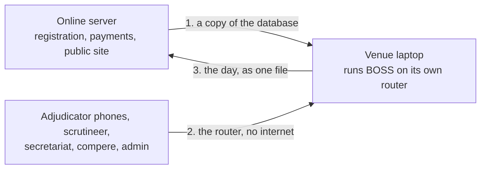

# Running a competition day with no internet

How to run the competition day on a laptop at the venue, so the whole day (admin, secretariat, scrutineer, chairperson, compere and the adjudicators' phones) works with no internet and no venue Wi-Fi. This is a **fallback**: the online server stays the normal way. Written for whoever sets up the venue. The online servers are covered in [../../deploy/PRODUCTION.md](../../deploy/PRODUCTION.md). A step-by-step version for people who are not technical is [OFFLINE_DAY_GUIDE.pdf](OFFLINE_DAY_GUIDE.pdf).

**Status:** the screen, the lock, the file routes and the venue server are built and tested in code. It has **not** been rehearsed on a real venue laptop, a real router and real phones, and the `.bat` files in `deploy/venue` have not been run end to end. Do that rehearsal before relying on it.

## How it works

1. **Before the event, online.** Registration and payments finish. The admin opens **Offline day** and presses **Start offline day** for the competition, then **Download database copy**.
2. **Competition day, offline.** The laptop runs the same BOSS program. Everyone joins the router's Wi-Fi and opens the laptop's address. Every role works as online, because it is the same program. The compere's screen is at `/compere`.
3. **After the event, online.** On the laptop the admin opens **Offline day** and downloads the day file. On the online server the admin presses **Load day file**, checks what it shows, and loads it.

**The online server keeps its hands off the competition meanwhile.** While it is handed over, staff changes (secretariat, scrutineer, chairperson, and the admin's own edits) and new entry requests are refused online with a message saying why. Reading, the athletes' own pages and the admin's offline-day buttons still work. This is blunt on purpose: it covers every competition, not only the one handed over. **Take back** releases it without loading anything.

## What you need

| | |
| --- | --- |
| **A laptop** | Windows with Docker Desktop. Plugged in all day, never asleep, with the right time and time zone. Another laptop as a spare is strongly advised |
| **A Wi-Fi router** | It does not need internet. It makes the network everyone joins. Give the laptop the same address every time (a "DHCP reservation" in the router's settings). Turn off "client isolation" or "AP isolation", or phones cannot reach the laptop |
| **A USB drive** | Gets a copy of every change, as a second place the data lives |
| **Paper** | The printed heat lists, recall lists and blank mark sheets from the Printouts page, in case of trouble |

## Before the event: set up the laptop

Do this a day or two before, with internet, then check it with the router and a phone.

1. **Put BOSS on the laptop.** Copy this repository to it. Open the `deploy\venue` folder.
2. **Online:** sign in as the admin, open **Offline day**, press **Start offline day** for the competition, then **Download database copy**. Put the downloaded `bis-venue-copy.db` in `deploy\venue` on the laptop. It holds every account and every password hash: keep it private and delete it from any USB drive afterwards.
3. **Double-click `setup.bat`.** It asks for the secret code (`DATA_KEY` from the online server's `deploy\.env`, without it the staff's two-step codes will not work) and the USB drive letter, then builds BOSS, loads the copy and starts it. It asks you to type YES because it replaces anything on the laptop.
4. **Check it from a phone.** Join the router's Wi-Fi and open the address `setup.bat` showed, followed by `/api/health`. It should show `"status":"ok"` and `"mode":"venue"`. Then open `/staff-access` and sign in.
5. **Print the PIN cards from the laptop.** Open the laptop's own address in its browser, sign in as the admin, and use **Adjudicators and panels → Print PIN cards**. The QR code on each card holds the address you opened, so cards printed from the laptop point at the laptop. Cards printed from the online site would not work at the venue.
6. **Rehearse.** On the router with real phones, run a whole round: start it, mark on three phones, approve, publish, and check the compere's screen. Pull the router's power for a minute during marking and check the phones keep their marks and send them when it is back.

The files in `deploy\venue`: `setup.bat` (first time and starting again from a copy), `start.bat` (after a restart, keeps everything), `stop.bat`, `show-address.bat`, `restore.bat` (spare laptop, below).

## On the day

- Everyone joins the router's Wi-Fi and uses the laptop's address: staff at `/staff-access`, the compere at `/compere`, adjudicators at `/adjudicator` (or by scanning their card).
- The laptop must stay on, plugged in and awake. Do not close the lid.
- Every change is also copied to the USB drive about every two minutes and after every change.
- Nobody at the venue needs the internet. Spectators' phones cannot see the public site from the venue Wi-Fi.

**If the router stops:** adjudicator phones keep their marks and send them when the Wi-Fi is back. Staff screens show Offline until then. Replace the router with the same settings.

**If the laptop stops:** on the spare laptop, set up BOSS as above (without a database copy), plug in the USB drive and double-click `restore.bat`. It starts from the newest backup. Give it the same address on the router. Phones then reload the page and carry on.

## After the event: send the day to the online server

1. **On the laptop,** open its address, sign in as the admin, open **Offline day** and press **Download day file** for the competition. Keep the file.
2. **Online,** take a backup first (the server already does one after every change). Open **Offline day**, press **Load day file** and choose the file. It first checks the file and shows what it holds. Press **Load it** to keep it.
3. The competition's day data is replaced, the floor is cleared, the competition is released, and the rankings and points show on the website.

## What goes back, and what does not

| Goes back | Does not |
| --- | --- |
| Rounds, heats, every adjudicator's marks and signatures, tie decisions, results and ranking points | Changes to accounts: passwords, staff accounts, two-step codes, photos |
| Late entries, scratches, and the payments and entry requests handled at the venue | Athletes' notifications |
| Panels, PINs and the program as edited at the venue | Anything about other competitions in the copy |
| New teams, coaches, dancers and events made at the venue, and back numbers | |

If a staff password was reset at the venue, do it again online.

## Limits

- The online pause covers all staff changes, not only the competition handed over. That is the price of a lock that cannot be bypassed by mistake.
- Importing a file replaces that competition's entries, payments and entry requests. Do not register or pay for it online between handing it over and loading the day (the online server refuses it).
- The laptop must be the same version of BOSS as the online server. The load refuses a file from a different version and says so.
- No sign-up, email links, forgot password, membership or payment review by email at the venue: there is no mail provider offline. Emails that would be sent are only printed in the laptop's log.

## If something does not work

| Problem | What to check |
| --- | --- |
| A phone cannot open the address | It is on the router's Wi-Fi, not mobile data. Client isolation is off. The address is the laptop's reserved one. Port 80 is allowed through the laptop's firewall |
| `setup.bat` says Docker is not running | Open Docker Desktop and wait until it says it is running |
| Staff are asked for a two-step code that fails | The secret code differs from the online server's `DATA_KEY`, or the laptop's clock is wrong |
| An adjudicator's PIN is refused | The laptop's date is wrong, or `ADJUDICATOR_PIN_DAYS` is too small for the competition's date. The PINs came with the copy: print new cards if the admin changed them |
| The wrong competition is "current" | The laptop's clock decides it. Fix the clock and double-click `stop.bat`, then `start.bat` |
| Loading the day says "different versions of BOSS" | Update the online server and the laptop to the same version |
| The online server says changes are paused | A competition is with a venue laptop. Load its day file, or press Take back on the Offline day page |
| Port 80 is already used | Set `VENUE_PORT=8080` in `deploy\venue\.env`, and use `http://<address>:8080` everywhere, including the PIN cards |
