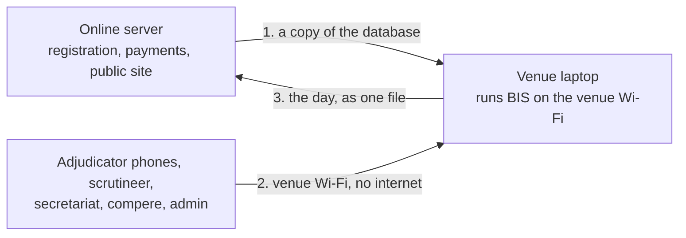

# Running a competition day with no internet

How to run the competition day on a laptop at the venue, so the whole day (admin, secretariat, scrutineer, chairperson, compere and the adjudicators' phones) works without any internet. Written for whoever sets up the venue. The online servers are covered in [../../deploy/PRODUCTION.md](../../deploy/PRODUCTION.md).

**Status:** built on the `offline-mode` branch and checked end to end on one computer (a copy of the database, the venue server over plain HTTP, the compere's screen, and the export and import of the day). It has **not** been rehearsed on a real venue laptop, a real router and real phones. Do that rehearsal before relying on it.

## How it works



1. **Before the event, online.** Registration and payments finish. You copy the online database to the laptop.
2. **Competition day, offline.** The laptop runs the same BIS program. Everyone joins the router's Wi-Fi and opens the laptop's address. Every role works exactly as online, because it is the same program. The compere's screen is at `/compere`.
3. **After the event, online.** The laptop writes the day's work to one file. You load it into the online server, which then shows the results, rankings and points.

**One rule keeps it safe:** while the laptop has the competition, nobody changes that competition on the online server. Its entries, payments, rounds and results are replaced by the laptop's when the file is loaded, so a change made online in the meantime is lost.

## What you need

| | |
| --- | --- |
| **A laptop** | Windows, Mac or Linux with Docker. Plugged in all day, never asleep, with the right time and time zone. Another laptop as a spare is strongly advised |
| **A Wi-Fi router** | It does not need internet. It makes the network everyone joins. Give the laptop the same address every time (a "DHCP reservation" in the router's settings). Turn off "client isolation" or "AP isolation", or phones cannot reach the laptop |
| **A USB drive** | Gets a copy of every change, as a second place the data lives |
| **Paper** | The printed heat lists, recall lists and blank mark sheets from the Printouts page, in case of trouble |

## Before the event: set up the laptop

Do this a day or two before, with internet, then check it with the router and a phone.

**1. Stop changing the competition online.** Finish registrations and payments, and agree that nobody runs rounds for this competition on the online server.

**2. Take a copy of the online database.** On the online server, in the `deploy` folder:
```
docker compose exec app sh -c 'ls -t /data/backups | head -1'
docker compose cp app:/data/backups/<the file name it printed> ./venue-copy.db
```
The backups are taken after every change, so the newest is up to date. Copy `venue-copy.db` to the laptop (USB drive or `scp`). It holds every account and every password hash: keep the file private and delete it from the USB drive afterwards.

**3. Put BIS on the laptop.** Copy this repository to the laptop (or `git clone` it), then:
```
cd deploy/venue
cp .env.example .env
```
Edit `.env` and set `DATA_KEY` to the **same** value as in the online server's `deploy/.env`. Without it the staff's two-step codes will not work. Set `USB_BACKUP` to a folder on the USB drive.

**4. Load the copy and start it.**
```
docker compose up --no-start
docker compose cp ./venue-copy.db app:/data/bis.db
docker compose up -d --build
```

**5. Check it from a phone.** Join the router's Wi-Fi and open `http://<the laptop's address>/api/health`. It should show `"status":"ok"` and `"mode":"venue"`. Then open `http://<the laptop's address>/staff-access` and sign in.

**6. Print the PIN cards from the laptop.** Open the laptop's own address in its browser, sign in as the admin, and use **Adjudicators and panels → Print PIN cards**. The QR code on each card holds the address you opened, so cards printed from the laptop point at the laptop. Cards printed from the online site would not work at the venue.

**7. Rehearse.** On the venue Wi-Fi with real phones, run a whole round: start it, mark on three phones, approve, publish, and check the compere's screen. Pull the router's power for a minute during marking and check the phones keep their marks and send them when it is back.

## On the day

- Everyone joins the router's Wi-Fi and uses the laptop's address: staff at `/staff-access`, the compere at `/compere`, adjudicators at `/adjudicator` (or by scanning their card).
- The laptop must stay on, plugged in and awake. Do not close the lid.
- Every change is also copied to the USB drive about every two minutes and after every change.
- Nobody at the venue needs the internet. Spectators' phones cannot see the public site from the venue Wi-Fi.

**If the router stops:** adjudicator phones keep their marks and send them when the Wi-Fi is back. Staff screens show Offline until then. Replace the router with the same settings.

**If the laptop stops:** on the spare laptop, set up as in steps 3 and 4, but use the newest backup from the USB drive instead of `venue-copy.db` (the file named `bis-…db` in the `USB_BACKUP` folder). Give it the same address on the router. Phones then reload the page and carry on.

## After the event: send the day to the online server

**1. On the laptop, make the day file.**
```
docker compose exec app node_modules/.bin/tsx src/db/day-export-cli.ts
```
With no options it lists the competitions here and their ids. Then:
```
docker compose exec app node_modules/.bin/tsx src/db/day-export-cli.ts --competition <id> --out /data/day.json
docker compose cp app:/data/day.json .
```

**2. Copy `day.json` to the online server,** into its `deploy` folder, and take a backup of the online server first.

**3. On the online server, try it without changing anything.**
```
docker compose cp ./day.json app:/data/day.json
docker compose exec app node_modules/.bin/tsx src/db/day-import-cli.ts --file /data/day.json
```
It prints what would change and keeps nothing.

**4. Keep it.** Run the same command with `--yes` on the end. The competition's day data is replaced, the floor is cleared, and the rankings and points show on the website.

## What goes back, and what does not

| Goes back | Does not |
| --- | --- |
| Rounds, heats, every adjudicator's marks and signatures, tie decisions, results and ranking points | Changes to accounts: passwords, staff accounts, two-step codes, photos |
| Late entries, scratches, and the payments recorded at the venue | Notifications and entry requests |
| Panels, PINs and the program as edited at the venue | Anything about other competitions in the copy |
| New teams, coaches, dancers and events made at the venue, and back numbers | |

If a staff password was reset at the venue, do it again online.

## Limits

- There is no screen for the copy or the file; they are commands. A screen can be added once the process has been rehearsed.
- Nothing stops someone changing the competition online while the laptop has it. The rule above is the only protection, so tell the secretariat and the admin.
- Importing a file replaces that competition's entries and payments. Do not register or pay for it online between taking the copy and importing the day.
- The laptop must be the same version of BIS as the online server. The import refuses a file from a different version and says so.

## If something does not work

| Problem | What to check |
| --- | --- |
| A phone cannot open the address | It is on the router's Wi-Fi, not mobile data. Client isolation is off. The address is the laptop's reserved one. Port 80 is allowed through the laptop's firewall |
| `docker compose up` says to set `DATA_KEY` | `.env` is missing or `DATA_KEY` is empty |
| Staff are asked for a two-step code that fails | `DATA_KEY` differs from the online server's, or the laptop's clock is wrong |
| An adjudicator's PIN is refused | The laptop's date is wrong, or `ADJUDICATOR_PIN_DAYS` is too small for the competition's date. The PINs came with the copy: print new cards if the admin changed them |
| The wrong competition is "current" | The laptop's clock decides it. Fix the clock and restart: `docker compose restart app` |
| The import says "different versions of BIS" | Update the online server and the laptop to the same commit |
| Port 80 is already used | Set `VENUE_PORT=8080` in `.env`, and use `http://<address>:8080` everywhere, including the PIN cards |
