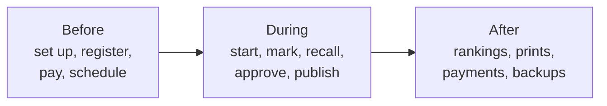

# How a competition runs in BIS

The whole journey of one competition, from setting it up to the rankings afterwards: who does what, on which page, and what the system does in response. Addresses are paths on the site (for example `/secretariat/entry-requests`); the screen name is what the sidebar or menu shows. Roles are explained in [ROLES_README.md](ROLES_README.md), accounts in [ROLE_ACCOUNTS.md](../operations/ROLE_ACCOUNTS.md), and step-by-step help for each role is in [guides/](../guides/).

## Who uses which part

| Role | Starts at | Works on |
| --- | --- | --- |
| Admin | `/staff-access` | `/admin/...` (competitions, staff, adjudicators, fees, payments, security) |
| Secretariat | `/staff-access` | `/secretariat/...` (events, entries, requests, schedule, program) |
| Scrutineer, Chairperson | `/staff-access` | `/scrutineer/...` (rounds, heats, live board, recall, results) |
| Compere | `/staff-access` | `/compere` (announcements) |
| Adjudicator | `/adjudicator` (PIN or QR) | `/adjudicator/mark` on a phone |
| Athlete, coach, team | Sign in on the public site, then `/login?as=athlete`, `coach` or `team` | `/athlete`, `/coach` or `/team` |
| Public | none | `/`, `/competitions`, `/rankings`, `/athletes` |

Staff sign in at `/staff-access`, which is not linked from the public site. Everyone else uses the **Sign in** button (in the menu on a phone).

---

## Part 1. Before the competition

### 1.1 Set up the system (Admin, once)

| Step | Where | What happens |
| --- | --- | --- |
| Fees and where to pay | `/admin/fees` (Fees and payment details) | Sets the registration fees and the GCash, Maya and bank details that teams and athletes are shown when they pay |
| Staff accounts | `/admin/staff` (Staff accounts) | One account per person; a temporary password is shown once. See [ROLE_ACCOUNTS.md](../operations/ROLE_ACCOUNTS.md) |
| Points table | `/admin/points` (Points table) | Points per place, used for rankings |
| Turn on two-step sign-in | `/admin/security`, `/secretariat/security`, `/scrutineer/security` | An authenticator code after the password, for Admin and Secretariat in particular |

### 1.2 Create the competition (Admin)

| Step | Where | What happens |
| --- | --- | --- |
| New competition | `/admin/competitions` → **New competition** | Name, date, organizer, venue, optional **Entries close** and **Fees due**, and a **card photo** (required). It appears on the home page and in `/competitions` |
| Adjudicators and panels | `/admin/adjudicators` | Add each adjudicator with a letter A to J, choose each event's panel |

### 1.3 Build the events and records (Secretariat)

| Step | Where | What happens |
| --- | --- | --- |
| Events | `/secretariat` (Events) | Add each event: age group, class, discipline, dances, solo or couple, and its kind (Beginners, Ranking, Inter-school, Closed to a province) so it is priced and checked correctly |
| Teams and coaches | `/secretariat/teams`, `/secretariat/coaches` | The teams and coaches named on the entry forms, once each, with the year their membership was paid |
| Competitors | `/secretariat/competitors` | **Add competitor** or **Import CSV**: the dancer and partner, team, province, coach, dates of birth, contact |
| Back numbers | `/secretariat/competitors` → **Assign back numbers** | Every competitor gets a number; one can be changed on its row |

### 1.4 People make accounts and link to their records

| Who | Where they act | Where the secretariat acts | Result |
| --- | --- | --- | --- |
| Athlete | Sign up at `/login?as=athlete`, fill in details at `/athlete` and `/athlete/edit`, report a membership payment at `/athlete/membership` | `/secretariat/athletes`: confirm or turn down the payment | Membership recorded for the year; an athlete whose email matches an entry form is not charged again |
| Coach or team | Sign up at `/login?as=coach` or `team`, then **Link your coach** or **Link your team** at `/coach/link` or `/team/link` | `/secretariat/account-links`: link or turn down | The account now sees its dancers, results, rankings, entries and (team) payments |
| Athlete, later | Ask to change their team or coach at `/athlete/edit` (other details save at once; coaches and teams edit theirs at `/coach/edit` and `/team/edit`) | `/secretariat/profile-changes` (Team and coach changes): approve or turn down with a reason | Until approved, the athlete's current team and coach stay |

Each decision reaches the person as a pop-up with a short sound and a saved notification (`/athlete/notifications`, `/coach/notifications`, `/team/notifications`).

### 1.5 Entries come in, three ways

| Way | Who and where | Then |
| --- | --- | --- |
| Entry form | Secretariat: `/secretariat/competitors` → **Enter in events** on the dancer | Pick the competition and events; the fee shows as you tick; choose how it was paid (cash, GCash, Maya, bank, or **Not paid yet**); red notes warn (age group, beginner rules, late entry) but do not stop the entry |
| Online by a team | Team: `/team/register` (Enter events) → pick dancer, competition and events, pay, attach a payment screenshot, **Send entry** | Shows as waiting at `/team/requests`. The secretariat is alerted with a pop-up |
| Online by an athlete | Athlete: `/athlete/register` for their own name, same steps | Same: `/athlete/requests` |

The secretariat decides each online entry at `/secretariat/entry-requests` (newest first): open the screenshot, check it against the money received, then **Approve** (the dancer is entered and the payment recorded with the screenshot) or **Turn down** with a reason. The sender is told and can fix and send again, or take a waiting request back. A request for an event already waiting, or already entered, is refused.

### 1.6 Payments

| Step | Where | What happens |
| --- | --- | --- |
| Ledger | `/admin/payments` | A read-only record of what each team owes and has paid, with how it was paid and who recorded it |
| Team pays later | `/secretariat/late-entries` → **Cash payments** | Mark a team's unpaid or rejected payment as paid at the venue; athlete and coach memberships in it are recorded then |
| Paying teams see it | `/team/payments`, `/athlete/payments` | Their own payment history |

Until an event's entries are paid, the scrutineer cannot start its round.

### 1.7 Schedule and program

| Step | Where | What happens |
| --- | --- | --- |
| Running order | `/secretariat/schedule` (Schedule) | Put the events in order |
| Program and times | `/secretariat/program` (Program) | Start times and the minutes for each round, following the WDSF rules |
| Public program | `/competitions/:id/program` | What is on the floor, what is next and when everything starts; Print and PDF are on the page |
| Entries and ranks | `/competitions/:id`, `/athletes`, `/rankings` | Public lists of events, athletes and rankings |

### 1.8 The day before

| Step | Who and where |
| --- | --- |
| Check the server's clock, `ADJUDICATOR_PIN_DAYS`, and take a backup | Admin, see [deploy/README.md](../../deploy/README.md) |
| Generate the PINs for the competition | Admin: `/admin/adjudicators` |
| Print the PIN cards | Admin: `/print/pin-cards/:competitionId`; each card has the six-digit PIN and a QR code. A PIN works one day either side of the competition date |
| Plan the rounds | Scrutineer: `/scrutineer` (Rounds) → **Plan rounds**, once; every event with entries gets its rounds |
| Check health | `/api/health` says ok, and there is no backup warning at the top of the screen |
| Rehearse | See [rehearsal/README.md](../../rehearsal/README.md) and [PILOT.md](../operations/PILOT.md) |

---

## Part 2. During the competition

### 2.1 Open

| Who | Where | What happens |
| --- | --- | --- |
| Adjudicators | `/adjudicator`: type the PIN or scan the QR code | Signs in on one phone at a time (signing in on another phone signs the first out). The phone shows `/adjudicator/waiting` ("Waiting for the next round") |
| Secretariat | `/secretariat/late-entries` | Add a late entry (cash at the venue or not yet paid; an unpaid late entry cannot dance). Use **Scratch** on an event page for a withdrawal (**Restore** undoes it before the event starts) |
| Secretariat | `/print` → Heat list, Recall list, Blank mark sheets | Paper for the floor and the paper fallback: `/print/heats/:eventId`, `/print/recall/:eventId`, `/print/blank-sheets/:eventId` |
| Compere | `/compere` | Waits for the first published round |

### 2.2 Each round, from first to last

| # | Who | Where | What happens |
| --- | --- | --- | --- |
| 1 | Scrutineer | `/scrutineer/heats` (Heats) | Check or edit who dances in which heat |
| 2 | Scrutineer | `/scrutineer` (Rounds) → **Start round** | The round goes on the floor and appears on every adjudicator's phone. It will not start while entries are unpaid; the message says how many. A wrong round can be taken **off the floor** until a phone has submitted |
| 3 | Adjudicators | `/adjudicator/mark` | Early rounds: mark an X for exactly the number of couples shown. Finals: place every finalist, first to last, in each dance. Press **Submit**, check the summary, sign with a finger, **Confirm** |
| 4 | Adjudicators | `/adjudicator/submitted` | "Submitted". Marks are saved on the phone first, so a dropped connection loses nothing; they send themselves when it is back |
| 5 | Scrutineer, Chairperson | `/scrutineer/live` (Live board) | Each phone goes from waiting to marking to submitted. A phone silent for 20 seconds is flagged; "Marks on the phone, not sent" means it is holding them. **Review the recall** (or **results**) appears when all are in |
| 6 | Scrutineer | `/scrutineer/recall` (Recall) | The X marks per competitor and the cut-off for the next round. A tie at the cut-off: the scrutineer proposes how to settle it, the chairperson presses **Confirm tie decision** |
| 7 | Scrutineer | `/scrutineer` → next round | Start the next round; heats follow the recall |
| 8 | Scrutineer | `/scrutineer/results` (Results) | For a final: the skating table. A tie in the final blocks approval until the scrutineer proposes (keep the shared place, or a tie-break order) and the chairperson confirms |
| 9 | Scrutineer | `/scrutineer/results` → **Approve results** | Saves the result, adds the ranking points and takes a backup |
| 10 | Scrutineer | `/scrutineer/results` → **Publish results** | Makes it public and shows it to the compere |

The chairperson sees the same screens but cannot start, approve or publish; every decision is stored with their name and the time.

### 2.3 What everyone else sees, live

| Who | Where | What |
| --- | --- | --- |
| Compere | `/compere` | The announcements for the round just published, places in large type, last place first. **Next announcement** and **Previous announcement** move through them. Nothing shows until publication |
| Public | `/competitions/:id/program` | What is on the floor now and what is next |
| Public | `/competitions/:id/events/:eventId` | Published results of an event |
| Public | `/rankings`, `/competitors/:id` | Updated the moment a result is approved |
| Athlete, coach, team | `/athlete/results`, `/coach/results`, `/team/results` | Their dancers' results |
| Staff | pop-ups on any page | Live alerts (a new entry request, an account link) with a chime. Adjudicators and the compere get none |

### 2.4 When something goes wrong

| Problem | What to do |
| --- | --- |
| A phone cannot send | The marks are safe on it. Switch to mobile data or another network and watch the Live board |
| A phone dies | Use the paper sheet; the scrutineer types it in at `/scrutineer/paper-marks` (Paper marks) |
| Wrong round started | **Take off the floor**, possible until a phone has submitted |
| A mistaken Confirm | The adjudicator tells the scrutineer before the round is approved |
| The scrutineer's laptop stops | Sign in again on any laptop; nothing is stored on the laptop |
| A backup warning | A backup folder failed. Tell the admin; results are still saved on the server |
| A PIN is refused | The admin generates a new one at `/admin/adjudicators` |

---

## Part 3. After the competition

| # | Who | Where | What happens |
| --- | --- | --- | --- |
| 1 | Scrutineer, Secretariat | `/print/results/:eventId`, `/print/scores/:eventId` | Print the final results and the scores sheets (with each adjudicator's signature) |
| 2 | Public | `/rankings`, `/competitors/:id` | Rankings already include every approved result; each competitor's page shows their points and history |
| 3 | Public | `/` and `/competitions` | The competition moves to **Latest competitions**; its program shows every round as Completed; a click opens that competition's results |
| 4 | Athlete, coach, team | `/athlete/rankings`, `/coach/rankings`, `/team/rankings` | See where their dancers stand |
| 5 | Admin, Secretariat | `/admin/payments` | Check the ledger; mark any cash still owed at `/secretariat/late-entries` |
| 6 | Admin | [deploy/README.md](../../deploy/README.md) | Confirm the backups (and the optional offsite copy) ran; the database is copied after every change |
| 7 | Admin | `/admin/adjudicators` | Collect or destroy the PIN cards. PINs stop working a day after the competition date |
| 8 | Admin | `/admin/security` | **Sign out everywhere** for a lost device, or end an account of someone who has left |
| 9 | Organizer | [PILOT.md](../operations/PILOT.md) | For a pilot event, compare every BIS result with the paper result and list fixes |

## Where the rules are checked

- **Skating System, ties and points:** `packages/scoring`, described in [PHASE2_README.md](../build/PHASE2_README.md).
- **Fees, age groups and entry warnings:** the secretariat entry form and `/admin/fees`.
- **Open questions and decisions already made:** [STATUS.md](../build/STATUS.md).
